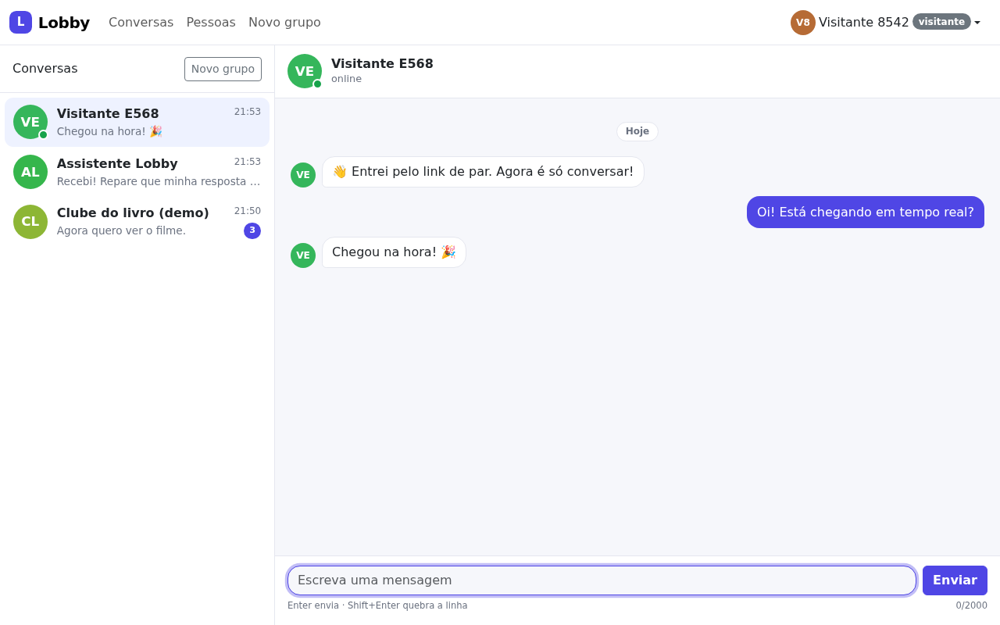
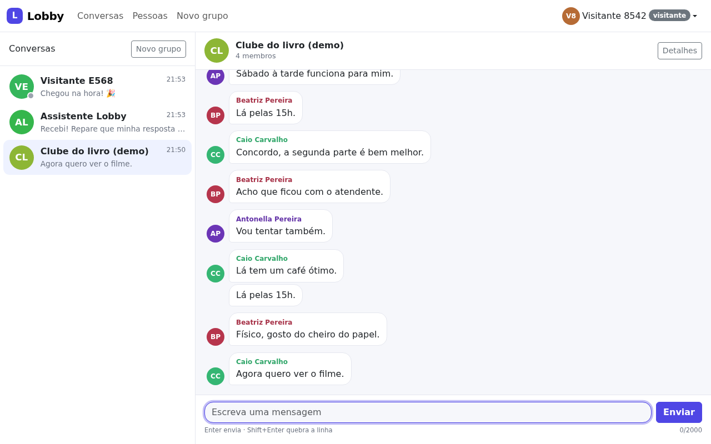
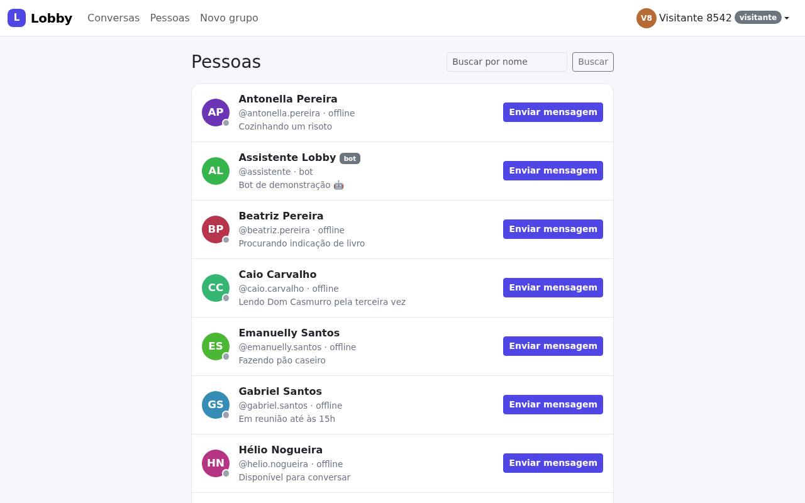
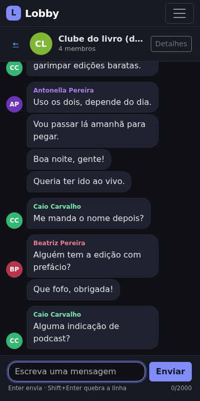
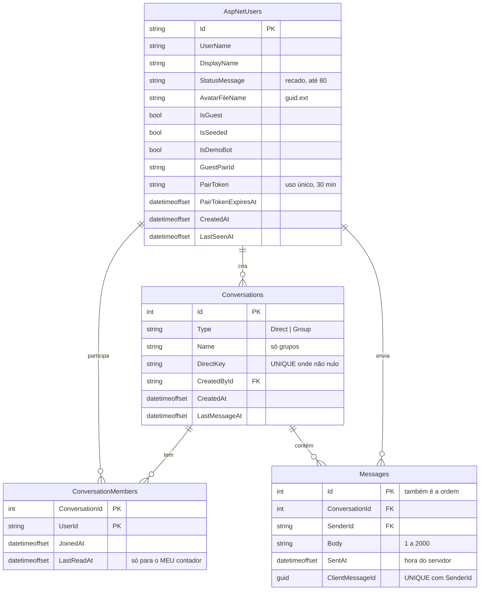
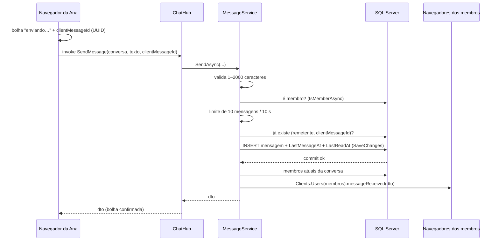

# Lobby

Bate-papo em tempo real feito com **ASP.NET Core MVC + SignalR**, Entity Framework Core e SQL Server.
É a versão .NET do projeto "Messaging App" do The Odin Project, com uma diferença central: as mensagens
chegam **na hora**, sem recarregar a página.

**Demo:** ainda não publicada. Quando estiver no ar: entre como convidado e abra o link de par em outra janela
(anônima ou outro navegador) para ver as duas janelas conversando em tempo real.



| Grupo de demonstração | Pessoas | Celular (modo escuro) |
|---|---|---|
|  |  |  |

Mais telas em [`docs/screenshots/`](docs/screenshots/): login, perfil, detalhes do grupo, lista no celular.

## O que ele faz

| Requisito do Odin | Como está no Lobby |
|---|---|
| Autenticação e autorização | ASP.NET Core Identity com cookie; cadastro, login, logout e "Entrar como convidado". Toda rota exige login, exceto as poucas marcadas com `[AllowAnonymous]`. |
| Enviar mensagens para outro usuário | Conversa direta criada sob demanda ("Enviar mensagem" em Pessoas), entregue em tempo real pelo SignalR. |
| Personalizar o perfil | Nome de exibição, recado e foto (upload validado); avatar de iniciais quando não há foto. |
| Publicar na web | Docker Compose para produção com Caddy (HTTPS automático); guia em [`docs/DEPLOY.md`](docs/DEPLOY.md). |
| Extra: conversas em grupo | Criar, adicionar pessoas (qualquer membro) e sair; o último a sair apaga o grupo. |
| Extra: quem está online | Bolinha verde ao vivo e "visto há 5 min". |
| Nosso: tempo real | SignalR com WebSockets, reconexão automática e recuperação das mensagens perdidas. |
| Nosso: histórico | Carrega 30 mensagens por vez ao rolar para cima, sem pular a posição da tela. |
| Nosso: demo para recrutadores | Visitante descartável, link de par, bot que responde e limpeza automática em 24 h. |

Fora do escopo, de propósito: imagens no chat, lista de amigos, confirmação de leitura, editar/apagar mensagens,
"digitando…", notificações push e escalar para vários servidores.

## Modelo de dados



Exclusões: só `Conversation → membros/mensagens` é cascata. Toda chave estrangeira que aponta para um usuário é
`Restrict`, porque o SQL Server não aceita dois caminhos de cascata até a mesma linha. Usuários só são apagados
pela limpeza de convidados, que apaga tudo em uma ordem explícita, dentro de uma transação.

## Uma mensagem, do Enter até a outra janela



## Por que `Clients.Users` e não um grupo do SignalR por conversa

Um grupo do SignalR guarda **conexões**, não pessoas. Se eu colocasse cada conversa em um grupo:

- quem fosse adicionado a um grupo de conversa enquanto já estava conectado só receberia mensagens depois de reconectar;
- quem saísse continuaria recebendo mensagens até reconectar, um vazamento de privacidade.

Consertar isso exigiria rastrear todas as conexões de cada usuário e atualizar os grupos a cada entrada e saída.
Em vez disso, a cada envio o servidor lê os membros **atuais** no banco (uma consulta indexada, a mesma regra
da checagem de acesso) e manda para `Clients.Users(ids)`. O SignalR entrega em todas as abas abertas de cada um.
Nada fica desatualizado. Grupo do SignalR só é usado onde o público é estável: a presença (grupo `directory`).
Detalhes em [ADR 0002](docs/adr/0002-clients-users-instead-of-groups.md).

## Presença (online/offline)

- `PresenceTracker` (singleton, em memória) conta **conexões** por usuário. Duas abas = duas conexões; a pessoa só
  fica offline quando a última fecha. Nesse momento gravamos `LastSeenAt`.
- Ao ficar online/offline, o hub avisa: usuários registrados para o grupo `directory` (todas as conexões de não
  convidados); convidados só para o seu par.
- **Limites**: um único servidor; o estado se perde ao reiniciar (os clientes reconectam em segundos); se a rede cair
  de repente, o servidor só percebe quando o tempo limite expira (~30 s); escalar exigiria um backplane (Redis),
  que não foi construído de propósito.

## Envio idempotente e recuperação após reconexão

- O navegador gera um `clientMessageId` para cada mensagem. Existe um índice único em `(SenderId, ClientMessageId)`.
- Se a conexão cai no meio do envio, o cliente não sabe se a mensagem foi salva. O botão "tentar novamente" reenvia
  com o **mesmo** id: se já estava salva, o servidor devolve a existente e não grava nem transmite de novo.
- Ao reconectar, o cliente pede `GET /c/{id}/messages?after={último id}` e atualiza a barra lateral, então nada do
  que chegou enquanto estava desconectado se perde.
- Mensagens repetidas na tela (as minhas outras abas também recebem o que eu envio) são ignoradas pelo `clientMessageId`.

## Segurança do upload de avatar

- [x] Tamanho: `[RequestSizeLimit]` no Kestrel **e** checagem do tamanho do arquivo (2 MB).
- [x] Só JPEG, PNG e WebP: extensão, **e** Content-Type, **e** os primeiros bytes do arquivo (assinatura). Os dois
  primeiros vêm do cliente e podem mentir; a assinatura não.
- [x] SVG nunca: é XML e pode conter `<script>`.
- [x] Nome no disco = `{guid}.{extensão detectada}`. O nome original nunca é usado (nem nos logs).
- [x] Arquivos fora do `wwwroot` e fora da imagem Docker, em um volume (`/data/avatars`).
- [x] Servidos por `GET /avatars/{nome}`, que só aceita nomes no formato que nós geramos (bloqueia `../`), com o
  Content-Type certo, `X-Content-Type-Options: nosniff` e cache longo.
- [x] Trocar a foto apaga a antiga; a limpeza de convidados apaga as deles.
- [ ] Próximo passo (não feito): **recodificar** a imagem no servidor para remover metadados e qualquer conteúdo escondido.

## Convidados, sandbox e reset automático da demo

- **Entrar como convidado** cria uma conta descartável (`convidado-7f3a`, "Visitante 7F3A") sem senha, com um
  kit de boas-vindas: conversa com o bot "Assistente Lobby" e o grupo "Clube do livro (demo)" com ~120 mensagens.
- **Link de par**: o convidado vê um link de uso único (30 min). Aberto em outra janela, cria um segundo convidado
  que já tem uma conversa com o primeiro. As duas janelas conversam ao vivo e veem a presença uma da outra.
  O link só é gasto ao clicar no botão (POST), para que pré-visualizações de link não o consumam.
- **Sandbox** (uma única consulta, `PeopleService.VisibleTo`): convidados veem só a si, ao seu par, às pessoas de
  demonstração e ao bot; ninguém vê convidados. Assim, desconhecidos não falam com visitantes e visitantes não falam
  com usuários reais.
- **Reset automático**: a cada hora, um `BackgroundService` apaga convidados com mais de 24 h (o par é apagado junto)
  e tudo o que criaram. As pessoas de demonstração e o bot não têm senha, então os dados de demonstração nunca mudam.

## Onde cada requisito da vaga aparece

| Vaga | Onde ver no código |
|---|---|
| C# / .NET 10 | Todo o projeto; records, primary constructors, `Lock`, pattern matching (`SqlException { Number: 2627 or 2601 }`). |
| ASP.NET Core MVC | `Controllers/`, `Views/`, PRG em `ChatController.Send`, partial views para histórico e barra lateral. |
| Web API / endpoints | `GET /c/{id}/messages`, `POST /c/{id}/read`, `GET /avatars/{nome}`, hub SignalR em `/hubs/chat`. |
| SQL relacional | Índice único filtrado, check constraint, chaves compostas, paginação por chave (keyset), cascata vs. restrict. |
| EF Core | `Data/AppDbContext.cs`, migrations, projeções em uma consulta (`ConversationQueries`), `ExecuteUpdate/ExecuteDelete`, estratégia de retry com transação (`GuestCleanup`). |
| HTML/CSS/Bootstrap | `Views/`, `wwwroot/css/site.css` (Bootstrap 5.3, modo escuro automático, layout responsivo). |
| JavaScript / jQuery | `wwwroot/js/chat.js` (dados do usuário só com `.text()`; `.html()` só com HTML já renderizado pelo Razor). |
| Git | Um commit por etapa; CI no GitHub Actions. |
| Testes | `tests/Lobby.Tests`: xUnit, SQL Server real via Testcontainers, testes de integração do SignalR. |
| Postman | Não usado: os endpoints retornam HTML para o navegador, e os testes de integração cobrem a API. |

## Como rodar

**Só Docker** (precisa do Docker Desktop ou Docker Engine com Compose v2):

```bash
git clone <este repositório> lobby && cd lobby
docker compose up --build
# abra http://localhost:8080
```

Na primeira vez o SQL Server leva 1–2 minutos para iniciar e o app cria o banco sozinho. No Mac com Apple Silicon,
a imagem do SQL Server é amd64 e roda emulada (mais lenta, mas funciona).

**Pela IDE** (Visual Studio, Rider ou VS Code), com só o banco no Docker:

```bash
docker compose up -d sqlserver
dotnet run --project src/Lobby.Web     # usa appsettings.Development.json → localhost:1433
```

**Testes** (precisam do Docker rodando, porque sobem um SQL Server descartável):

```bash
dotnet test
```

**Nova migration**:

```bash
dotnet tool restore
dotnet ef migrations add NomeDaMudanca -p src/Lobby.Web -o Data/Migrations
```

**Zerar banco e avatares**: `docker compose down -v` (apaga os volumes `sqldata` e `appdata`).

## Documentação

- [`docs/STUDY_GUIDE.md`](docs/STUDY_GUIDE.md): roteiro de estudo, a vida de uma mensagem.
- [`docs/adr/`](docs/adr/): as decisões de arquitetura e o porquê de cada uma.
- [`docs/DEPLOY.md`](docs/DEPLOY.md): publicar em uma VPS (sozinho ou dividindo com outros apps) e no Azure.
- [`docs/PROGRESS.md`](docs/PROGRESS.md): o que foi feito em cada etapa.
